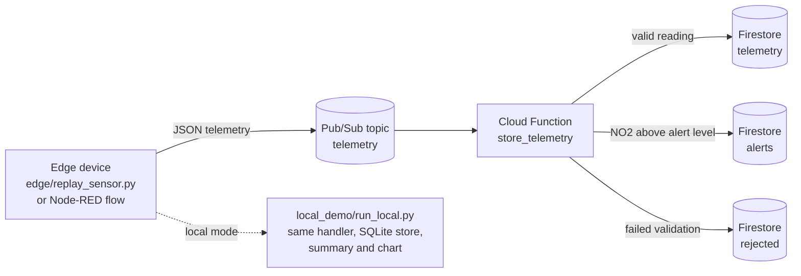
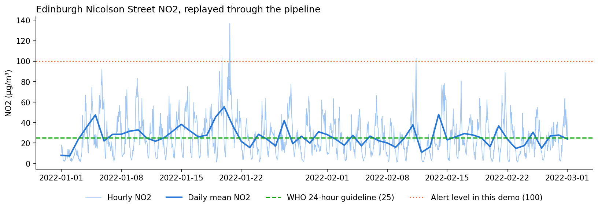

# Smart City Air Quality Monitoring: IoT to Cloud Pipeline

An event-driven IoT pipeline that streams air quality readings from a roadside sensor to the cloud, validates them, stores them, and raises alerts. It replays two months of real hourly nitrogen oxide (NO) and nitrogen dioxide (NO2) readings from Edinburgh Nicolson Street as if they came from a live device.

The whole pipeline also runs on a laptop with no cloud account, so it can be tested and demonstrated in one command.

## Architecture



| Part | What it does |
|---|---|
| `edge/replay_sensor.py` | Edge device simulator. Reads the sensor sheet, skips "No data" rows, and sends one JSON message per hour of data, to the terminal or to a Pub/Sub topic. `--speed 3600` replays one hour per second. |
| `cloud_functions/main.py` | Pub/Sub-triggered Cloud Function. Validates each message, stores it in Firestore with an idempotent id (`<device>-<timestamp>`, so a replay does not create duplicates), writes alerts when NO2 is high, and keeps rejected messages with their reasons. |
| `pipeline/core.py` | Shared parsing, validation and alert rules used by the edge script and the local demo. Tests check that the Cloud Function applies the same rules. |
| `local_demo/run_local.py` | Runs edge to handler to storage on a laptop, with SQLite in place of Firestore, then writes a summary table and a chart. |
| `nodered_flows/` | Node-RED prototype flows: a sheet reader that converts readings to numbers, a device simulator that publishes test objects to Pub/Sub, and a subscriber that parses incoming telemetry. |

### Message format
```json
{"device_id": "edns-01", "site": "EDNS", "ts": 1640998800, "no_ugm3": 6.24, "no2_ugm3": 17.98, "iso_time": "2022-01-01T01:00:00+00:00"}
```

### Alert rules
| Level | Rule |
|---|---|
| `limit` | NO2 above 200 µg/m³ in an hour (the UK hourly objective level) |
| `elevated` | NO2 above 100 µg/m³ (an early-warning level chosen for this demo, configurable) |

## Run it locally (no cloud account)
```bash
python3 -m venv .venv && source .venv/bin/activate
pip install -r requirements.txt
python -m pytest -q                       # tests for parsing, validation, alerts and the function
python edge/replay_sensor.py --limit 5     # print the first five telemetry messages
python local_demo/run_local.py             # full pipeline: writes local_demo/out/
```

## Results from the local run
1,416 rows in the sheet, 11 of them "No data", so 1,405 readings from 1 January to 28 February 2022.

| Metric | Value |
|---|---|
| Messages processed | 1,406 (1,405 readings plus one deliberately broken test message) |
| Stored | 1,405 |
| Rejected | 1 (the broken test message) |
| Alerts (NO2 above 100 µg/m³) | 3 |
| Hours above the UK hourly objective (200 µg/m³) | 0 |
| Mean NO2 | 26.4 µg/m³ |
| Highest hourly NO2 | 136.7 µg/m³ |
| Days with a daily mean above the WHO 24-hour guideline (25 µg/m³) | 32 of 60 |



Full table: [`local_demo/out/summary.csv`](local_demo/out/summary.csv).

## Deploy to Google Cloud
Needs a Google Cloud project with billing, and the `gcloud` CLI.
```bash
gcloud pubsub topics create telemetry
gcloud firestore databases create --location=europe-west2
cd cloud_functions
gcloud functions deploy store_telemetry --runtime python312 --trigger-topic telemetry \
    --entry-point store_telemetry --region europe-west2
cd ..
pip install -r requirements-cloud.txt
python edge/replay_sensor.py --sink pubsub --project YOUR_PROJECT_ID --topic telemetry --speed 3600
```
Use a service account with only Pub/Sub Publisher rights for the edge device. Never commit key files; `.gitignore` excludes them.

## Data
- `data/edinburgh_sensor_data.xlsx`: hourly NO and NO2 (µg/m³) from the Edinburgh Nicolson Street monitoring site (site code EDNS on the [Scottish Air Quality](https://www.scottishairquality.scot/latest/site-info/EDNS) website), 1 January to 28 February 2022.
- The sheet labels the last hour of each day as 00:00 on the same date, so the unix `timestamp` column is used as the time of record.
- Check the Scottish Air Quality data terms before reusing the data elsewhere.

## Limitations
- One site and two winter months; not a city-wide picture.
- Readings are replayed, not streamed from live hardware.
- The 100 µg/m³ alert level is a demo setting, not a regulatory limit. The UK annual NO2 objective (40 µg/m³) needs a full year and is not assessed here.

## Next steps
- A longer record from the same site and short-term NO2 forecasting (persistence baseline, gradient boosting and a small LSTM).
- A live dashboard over the Firestore data.

## Licence
Code: MIT ([`LICENSE`](LICENSE)). Data: see the Data section.

## Author
Muzammal Hussain, Software Engineer, Data Scientist and AI Researcher · [GitHub](https://github.com/MHKhan50)
